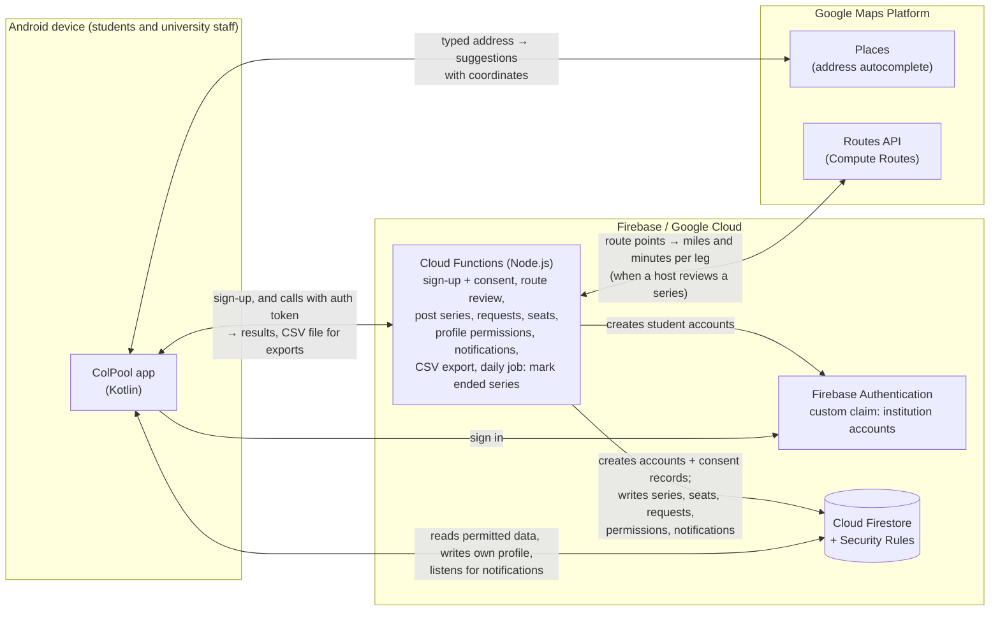

# ColPool — Software Design Document (SDD)

CSCI 5520 – AI-Driven Software Development

| | |
|---|---|
| **Student Name** | Ethan Walden |
| **Date** | November 7, 2026 |
| **Document Version** | v0.5 |
| **Project Repository / URL** | https://github.com/EthanScottWalden/ColPool |

---

## 1 Problem & Users

### 1.1 Problem Description

Many college students commute to campus by car, and the cost of that daily round trip adds up quickly. Fuel, parking, and ride-share services like Uber put a recurring strain on budgets that must already cover food, course materials, and other necessities. Students without consistent support often take part-time jobs to cover these costs, and balancing work, class, and an expensive commute adds stress.

Sharing rides could cut those costs, but finding a workable carpool is hard. A carpool partner has to live nearby and have a schedule that lines up in both directions, to campus in the morning and home again later, on the same days of the week. Students have no reliable way to find classmates who meet all of those conditions. Arrangements depend on who a student already happens to know, and a student who finds a ride to campus may still have no way home.

Commuters also face social disadvantages compared to peers who live on campus. They spend less time there, which makes it harder to build friendships and take part in campus life, and this isolation adds to the stress they already carry.

Universities are affected as well. Parking is expensive to build and maintain. Many institutions also report how students commute, both for sustainability ratings and emissions inventories and for campus transportation planning. Yet universities have little reliable information about which students carpool, when, and how far they travel. They typically rely on occasional surveys, so they can't measure carpooling or plan around it.

**Therefore, the core problem is this:** Commuting college students lack a practical way to find nearby students with compatible schedules to share regular round-trip commutes, which leaves them with higher transportation costs and fewer social connections. At the same time, their universities lack reliable data on student carpooling to inform parking, sustainability and transportation decisions.

### 1.2 Target Users & Stakeholders

**Primary Users:**

- **Commuting students who drive (ride hosts):** They have a car and a regular schedule, and want to cover fuel costs by taking riders who live nearby.
- **Commuting students who need rides (riders):** They want a dependable, affordable round trip with someone who lives nearby and keeps a compatible schedule. One account can act as a host and as a rider.
- **University staff:** Someone in the transportation, parking or sustainability office uses an institution account to export carpooling data for reporting and planning. They don't take part in rides.

**Stakeholders:**

- **The university (CBU for the MVP):** It benefits when commuters get to campus affordably and reliably, through less parking demand, better commute data for sustainability reporting and planning, and more engaged commuter students. It also has a responsibility to protect the student data it receives.

---

## 2 Proposed Solution & Scope

### 2.1 Proposed Solution

ColPool is an Android app that helps commuting students at the same university set up regular, shared round-trip commutes to and from campus.

A student with a car hosts a **ride series**: a recurring round trip from one fixed pickup spot to campus and back, on chosen weekdays, across a date range such as a semester. Students who need rides search for series near the address they leave from, and request the weekdays that fit their class schedule. Once the host accepts, the rider travels with the same host at the same times on those weekdays until either of them cancels or the series ends. Riders pay the host a flat cash price per round trip, directly and outside the app.

Matching prioritizes **proximity**. Search results are ordered by how close each series' pickup spot is to the rider's starting address. Profile details such as interests, major, year and commute style appear alongside as a secondary sign of compatibility. A mapping service calculates each series' route, distance and expected times automatically, including any stops the host makes along the way.

The university receives an **institution account** that exports a weekly spreadsheet of scheduled student carpool trips: who rode with whom, on which days, from which pickup spot, and estimated miles traveled.

**Expected value:**
- **For students:** lower commuting costs, and a dependable way both to campus and home again. Because riders travel with the same people on a regular schedule, relationships form naturally over repeated rides, which eases the isolation commuters experience.
- **For the university:** measurable data on student carpooling to inform parking, sustainability reporting and transportation planning.

### 2.2 Minimum Viable Product (MVP) Scope

**Accounts and consent**
- University-based login, starting with California Baptist University (`@calbaptist.edu` emails only).
- Students create their own accounts. Institution accounts belong to university staff. They are created by ColPool's developers, not through sign-up, and can only export data.
- At sign-up, students must agree to a data-sharing consent statement: their scheduled carpool activity, including names, ride partners, days, pickup spots and estimated miles, will be shared with their university. Agreeing is required to create an account. The statement reads: "**Data-sharing consent.** I agree that my scheduled carpool activity (my name, email, who I ride with, which days, pickup spots and estimated miles) will be shared with my university."

**Profiles and onboarding**
- First and last name are required.
- A **starting address**, the place the student usually leaves from, entered with address autocomplete. It is used only to rank search results, and is never shown to other users. It can be changed at any time from the profile.
- Optional profile fields: age, gender, interests, major, current year, commute-style traits (chatty, quiet, chill, friendly, music-friendly, no music, and possibly more), and an about-me section. Interests, major, year and traits are chosen from predefined options.
- An onboarding page after sign-up prompts students to fill in these fields.
- Users can always view their own profile. They can view other users' profiles only under the circumstances described in the rules on profile visibility.

**Hosting a ride series**
- A host posts a ride series with:
  - a pickup spot (address with autocomplete)
  - a start date and end date
  - a flat cash price per round trip, in whole dollars from $1 to $99
  - a vehicle description
  - a maximum number of riders, from 1 to 6
  - one or more weekdays, each with its own schedule:
    - **To campus:** departure time from the pickup spot, optional stops in order, and a campus drop-off point.
    - **To pickup spot:** a campus pickup point and departure time from it, plus optional stops in order.
  - Campus drop-off and pickup points are chosen from a short list of campus locations set up for the university. For CBU the MVP list is Yeager Center, Music Building, Health Science, Lancer Plaza and Events Center.
  - for each stop, its address and the number of minutes the host expects to spend there, from 0 to 120
- Departure times, stops, time spent at stops, and campus drop-off and pickup points can all be different for each weekday and each direction. For example, Monday's trip to campus may have no stops while Wednesday's has two, Monday's return trip may leave at a different time than Tuesday's, and riders may be dropped off at one campus parking lot in the morning and picked up at another in the afternoon.
- Stops are for the host only, such as errands or dropping off a family member. Riders board and leave only at the pickup spot and the campus drop-off and pickup points.
- The pickup spot and every stop address are visible to every student who searches. When posting, the host sees a note recommending public places, such as a parking lot or gas station, rather than a home or school address.
- When the host continues to review the series, before posting, ColPool calculates the route for each weekday and direction with a mapping service, assuming the service's recommended route between each pair of consecutive points. The review screen shows:
  - miles and driving minutes for each leg
  - the expected arrival and departure time at each stop, including the time spent there
  - the expected arrival at the campus drop-off point
  - the expected return to the pickup spot
- Posting saves exactly the routes and times the host reviewed. If the host goes back and changes the series, the routes are calculated again at the next review.
- Every field except stops is required. The start date cannot be in the past, the end date cannot be before the start date, and at least one date in that range must fall on one of the series' weekdays. On each weekday, the host must leave campus no earlier than the expected arrival at campus. A student can host at most five active series, and no two of them can share a weekday during overlapping dates. A host also can't post a series on a weekday they ride in another series during overlapping dates (RC-32). A series cannot be edited after posting. Riders accepted into a series agreed to its original schedule, and many would drop out if it changed, so a host who needs different details cancels the series and posts a new one.
- The host can cancel the whole series at any time, which ends all of its remaining scheduled trips.
- Remaining seats are tracked separately for each weekday and update automatically.

**Searching for a ride series**
- A rider chooses the weekdays they need. Results show series with an open seat on at least one of those weekdays, and indicate which weekdays match.
- Results are ordered by straight-line distance from the rider's starting address to the series' pickup spot, nearest first.
- Riders can optionally set preferred interests, major, year and traits. Each result then shows a match percentage, but the percentage does not change the order of results.
- Search never shows the rider's own series, series they have already requested, series that have been cancelled, or series that have ended.
- Riders can view the host's profile and the full schedule from a search result.

**Requests and riding**
- A rider sends one request per series, listing the weekdays they want. The host accepts or declines each requested weekday separately. For example, a rider who asks for Monday and Wednesday can be declined for Monday and accepted for Wednesday. Riders can request a series that has already started, as long as seats are open, and ride each accepted weekday from its first trip that departs after the weekday is accepted.
- A weekday can be accepted only if it has an open seat. When a weekday fills up, that weekday is declined automatically in every pending request that includes it; the request's other weekdays are not affected.
- A weekday with no trips left (its last departure before the end date has passed) can't be found in search, requested or accepted (RC-33).
- A student can't be scheduled in two places on the same weekday. They can't be accepted on a weekday they already ride in another series or host, during overlapping dates. When one of their weekdays is accepted, any conflicting pending weekday in their other requests is declined automatically (RC-32).
- The rider can leave any accepted weekday, or withdraw any pending weekday, at any time, one weekday at a time or all at once. The host can remove a rider from any of their accepted weekdays at any time, one weekday at a time. A rider cannot request the same series twice, and cannot rejoin a weekday they left, were removed from, or were declined for.
- A rider is assumed to ride every scheduled trip on each accepted weekday that departs from the pickup spot after the weekday was accepted, and before the rider leaves that weekday, the host removes them from it, or the series is cancelled or ends. For example, a Monday accepted on Monday evening starts with the next Monday's trip, and a rider who leaves Monday at noon is still counted for that morning's trip.
- Hosts can see each of their series, the riders on each weekday, incoming requests, and the profiles of requesters and accepted riders.
- Riders can see their pending and accepted requests, with each series' full schedule and the host's profile. Once accepted, they can also see the profiles of the other riders who share their weekdays, so that people who ride together regularly know who they are riding with.
- Once a series' end date has passed, it no longer appears to the host or its riders. Its data is kept for the institution export.

**Notifications**
- In-app banner notifications, plus a notification history with unread indicators, for:
  - a new request
  - a requested weekday being accepted, declined or automatically declined (because it filled up, or because of a schedule conflict)
  - a rider being removed from a weekday by the host
  - a rider leaving an accepted weekday
  - a rider withdrawing a pending weekday from their request
  - a series being cancelled
  - a series reaching its end date

**Institution data export**
- The institution account can export a CSV file that opens in Excel, covering any date range the staff member chooses that ends no later than today. Each row covers one student, one series and one week, and includes:
  - the student's name and email
  - whether they hosted or rode in the series
  - the host's name
  - the pickup spot
  - the weekdays and dates scheduled
  - the number of scheduled round trips
  - estimated miles, based on the full round-trip route including stops: **passenger miles** on rider rows and **vehicle miles** on host rows, labelled so the two are not added together
- A host's trip counts only when at least one accepted rider's trip counts on it, following the same departure-time rule.
- The export is labelled as *scheduled* trips, not verified trips.
- The file is shared through Android's standard share menu, for example to email or Google Drive.

### 2.3 Out of Scope / Non-Goals

- Any form of in-app messaging, video calls, or communication beyond what is specified in the MVP.
- In-app payments through Stripe or similar.
- Driver ratings, public or private.
- Multi-university support.
- Map display, turn-by-turn navigation, GPS, or current-location detection. Locations are typed addresses only.
- Real-time ride tracking, live-traffic ETAs, or recalculating expected times after a series is posted.
- Pickup or drop-off points for individual riders. Riders board and leave only at the series' pickup spot and its campus drop-off and pickup points.
- One-way sign-ups. Riders always take the round trip on their weekdays.
- Rides that do not start at a pickup spot, go to campus and return. ColPool does not support trips between two off-campus locations.
- Editing a posted series, skipping individual dates, or excluding holidays within a series' date range.
- Confirming trip completion or tracking attendance. The export reflects scheduled trips only.
- Institution dashboards, charts, web portals, or automatically emailed reports. Institution accounts also cannot moderate content or manage users.
- Complex search queries or filters beyond weekday selection and preferences.
- Terms of service or privacy policy documents. The only agreement is the data-sharing consent statement at sign-up.
- Deleting accounts or carpool records, or withdrawing data-sharing consent once given.
- Pictures, video, music, animations, themes, or similar on user profiles.
- Push notifications. Notifications are in-app only.
- ID scanning, license verification, background checks, or any other external form of driver verification besides university login.
- Password resets.
- Email verification. Sign-up checks only that the email ends in `@calbaptist.edu`; it does not confirm that the student controls the address.

---

## 3 User Stories & Acceptance Criteria

### 3.1 Accounts and Profiles

**US-01 – University Login**
- **User Story:** As a student, I can create an account and sign in with my CBU email and a password, so that I can use ColPool. As a university staff member, I can sign in with an institution account provided to me, so that I can export carpool data.
- **Pass/Fail Check:** Sign-up succeeds only with an `@calbaptist.edu` email, a password, a first and last name, and agreement to the data-sharing consent statement; it cannot be completed without agreeing. Sign-in succeeds only with a registered email and its matching password. Institution accounts cannot be created through sign-up, and a staff member signed in with one sees only the data export.

**US-02 – Profile and Onboarding**
- **User Story:** As a student, I can set up and edit my profile, including where I usually leave from, so that I am matched with nearby rides and other students know who they are riding with.
- **Pass/Fail Check:** After sign-up, an onboarding page asks for a starting address, entered with address autocomplete, and offers the optional fields: age, gender, interests, major, current year, commute-style traits and about me. The starting address is required; the other onboarding fields can be skipped. A student who signs in before entering a starting address, for example after quitting onboarding, is taken back to onboarding. Name and starting address can be edited but not removed; optional fields can be added, edited or removed at any time. The starting address never appears to any other user. Users can always view their own profile.

### 3.2 Hosting

**US-03 – Host a Ride Series**
- **User Story:** As a student with a car, I can post a recurring round trip between my pickup spot and campus, so that nearby students with compatible schedules can join it.
- **Pass/Fail Check:** A series can be posted only with a pickup spot (entered with address autocomplete), a start and end date, a flat cash price per round trip, a vehicle description, a maximum number of riders, at least one weekday, and, for each weekday, a departure time from the pickup spot, a campus drop-off point, a campus pickup point for the return trip, and a departure time from that campus pickup point. Campus drop-off and pickup points are chosen from the university's list and can differ by weekday and by direction. Each weekday and direction can have its own ordered stops, each with an address and the minutes the host expects to spend there. While entering the pickup spot and stops, the host sees a note recommending public places rather than a home or school, since these addresses are visible to every student who searches. A series cannot be posted if a required field is missing or outside its allowed range (RC-30), if its start date is in the past, if its end date is before its start date, if no date in its range falls on one of its weekdays, if on any weekday the departure time from campus is earlier than the expected arrival at campus, if it would break the hosting limits in RC-31, or if it runs on a weekday the host is accepted on as a rider during overlapping dates (RC-32). A posted series cannot be edited. Open seats are tracked separately for each weekday.

**US-04 – Calculated Route and Times**
- **User Story:** As a student, I can see how far each trip goes and when it reaches each point, so that I know when to be ready and how long the commute takes.
- **Pass/Fail Check:** For each weekday and direction, the series shows the total miles, the driving minutes, and the expected time at each stop, at the campus drop-off point (trip to campus), and at the pickup spot (return trip). Each expected time equals the departure time plus the driving time of every earlier leg, along the mapping service's recommended route, plus the minutes spent at every earlier stop. Distances and times are calculated when the host continues to the review screen, before posting, so the host sees them first. Posting saves exactly what was reviewed, and the values do not change afterwards. If the series was reviewed on an earlier day and its start date has since passed, posting fails and the host must fix the dates and review again.

**US-05 – View Hosted Series**
- **User Story:** As a student, I can view all of the ride series I host, so that I can keep track of who is riding with me on which days.
- **Pass/Fail Check:** The host sees every series they host that has not been cancelled and whose end date has not passed, with its full schedule and, for each weekday, the accepted riders and the number of open seats. Series whose end date has passed no longer appear.

**US-06 – Cancel a Ride Series**
- **User Story:** As a student, I can cancel a ride series I host, so that riders do not expect trips that will not happen.
- **Pass/Fail Check:** Cancelling requires confirmation. A cancelled series disappears from search and from the host's and riders' lists, all of its remaining trips end, its pending weekdays become declined, and every rider with a pending or accepted request gets one cancellation notification (not a separate decline notification for each weekday). Trips that departed before the cancellation remain in the institution export.

**US-07 – View Incoming Requests**
- **User Story:** As a student, I can view all requests for each series I host, so that I know who wants to join and who is already riding.
- **Pass/Fail Check:** For each series, the host sees every request with at least one pending weekday, with the requester's name and the status of each requested weekday (pending, accepted or declined), and sees the accepted riders for each weekday.

**US-08 – Manage Requests**
- **User Story:** As a student, I can accept, decline or remove riders on a series I host, so that I control who rides with me.
- **Pass/Fail Check:** The host accepts or declines each pending weekday of a request separately; deciding one weekday does not change the others. A weekday can be accepted only if it has an open seat, has trips left (RC-33) and doesn't conflict with the rider's schedule (RC-32), and accepting it reduces that weekday's open seats by one. A request leaves the host's list of requests once none of its weekdays are pending. The host can remove a rider from any one of their accepted weekdays at any time, which reopens one seat on that weekday and leaves the rider's other weekdays unchanged. When a weekday reaches its maximum riders, that weekday is declined automatically in every pending request that includes it.

### 3.3 Riding

**US-09 – Search for Ride Series**
- **User Story:** As a student, I can find ride series that leave near me on the days I need, so that I can get to campus and back home.
- **Pass/Fail Check:** The rider selects one or more weekdays. Results include only series with an open seat and trips left (RC-33) on at least one selected weekday, and mark which of the selected weekdays are available. Results are ordered by straight-line distance from the rider's starting address to each pickup spot, nearest first, and each result shows that distance. Results never include the rider's own series, series the rider has already requested, cancelled series, or series whose end date has passed. The rider can open any result to see its full schedule and the host's profile.

**US-10 – Preference Match**
- **User Story:** As a student, I can choose the interests, major, year and commute style I would like in a host, so that I can see which nearby rides suit me best.
- **Pass/Fail Check:** The rider can select any number of preferred interests and traits, and at most one preferred major and one preferred year. Each search result then shows a match percentage. The percentage does not change the order of results. Clearing all preferences removes the percentage.

**US-11 – Request to Join**
- **User Story:** As a student, I can request to join a series on the weekdays that fit my schedule, so that I have a regular ride to campus and back.
- **Pass/Fail Check:** The rider selects one or more of the series' weekdays and sends a request. A request can be sent only if each selected weekday has an open seat and trips left (RC-33), no selected weekday conflicts with a weekday the rider is already accepted on or hosts (RC-32), the series is not the rider's own, and the rider has never requested this series before. A series that has already started can be requested; the rider rides each accepted weekday from its first trip that departs after the weekday is accepted.

**US-12 – Leave Days or Cancel a Request**
- **User Story:** As a student, I can leave or withdraw individual weekdays of a series, or all of them at once, so that I am not committed to rides I no longer need.
- **Pass/Fail Check:** Each action requires confirmation. Leaving an accepted weekday reopens one seat on that weekday and notifies the host; withdrawing a pending weekday removes it from the host's pending requests and also notifies the host. The rider's other weekdays are unchanged. Leaving all weekdays ends the rider's participation in the series. The rider cannot rejoin a weekday they left and cannot request the series again.

**US-13 – View My Rides**
- **User Story:** As a student, I can see every series I have requested or joined, so that I know when and where I am being picked up and who I am riding with.
- **Pass/Fail Check:** The rider sees every pending and accepted request on a series that has not been cancelled and whose end date has not passed. Each shows the status of each requested weekday (pending, accepted or declined), the schedule and expected times for its pending and accepted weekdays, the price, the pickup spot and the host's profile. For each accepted weekday, the rider can also open the profiles of the other riders accepted on that weekday. Series whose end date has passed no longer appear.

**US-14 – View Profiles of People in My Series**
- **User Story:** As a student, I can view the profiles of the people involved in my series, so that I can make informed decisions and get to know the people I ride with.
- **Pass/Fail Check:** A host can open the profile of anyone with a pending or accepted request on their series. A rider can open the profile of the host, and of other riders accepted on a weekday the rider is also accepted on. No other profiles can be opened from these screens.

### 3.4 Notifications

**US-15 – Ride Notifications**
- **User Story:** As a user, I receive in-app notifications about changes to my series and requests, so that I stay informed about my commute.
- **Pass/Fail Check:** A banner appears at the top of the screen and disappears automatically after a short time when any of these events occur:
  - a new request arrives on one of the user's series (host)
  - a weekday of the user's request is accepted, declined, or automatically declined because it filled up or because of a schedule conflict (RC-32) (rider); each weekday decision sends its own notification, even when the host decides several weekdays at once
  - the host removes the user from a weekday (rider)
  - a rider leaves one of their accepted weekdays (host)
  - a rider withdraws a pending weekday from their request (host)
  - a series the user has a pending or accepted request on is cancelled (rider)
  - a series the user hosts, or has a pending or accepted request on, reaches its end date (host and riders)

  When a series is cancelled or ends, its pending weekdays become declined without separate decline notifications; the single cancellation or end notification covers them.

**US-16 – Notification History**
- **User Story:** As a user, I can view my past notifications, so that I can catch up on updates I missed while away from the app.
- **Pass/Fail Check:** Users can open a scrollable list of past notifications, newest first. Each includes the event type, the related series, and a timestamp. Unread notifications are clearly marked, and the app shows when any are unread.

### 3.5 University

**US-17 – Export Carpool Data**
- **User Story:** As a university staff member, I can export student carpool data for a date range I choose, so that the university can use it for parking, sustainability reporting and transportation planning.
- **Pass/Fail Check:** The staff member chooses a start date and an end date no later than today (in the university's time zone) and exports a CSV file that opens in Excel. A range with a start date after its end date, or an end date after today, is rejected. The file has one row for each student, series and calendar week (Monday to Sunday) within the range that has at least one scheduled round trip. Each row contains the student's name and email, whether they hosted or rode, the host's name, the series' pickup spot, the dates of scheduled round trips that week, the number of scheduled round trips, and the estimated miles (the series' round-trip route miles for each scheduled trip), labelled as passenger miles on rider rows and vehicle miles on host rows so the two are not added together. A host's trip counts only if at least one accepted rider is scheduled on it. Trips count according to RC-23, so trips from cancelled and ended series are included if they departed before the series was cancelled or ended. The file states that it lists scheduled trips, not verified ones. It can be shared through Android's standard share menu. Only institution accounts can export.

---

## 4 Requirements, Constraints & Design Rules

### 4.1 Access, Privacy and Consent

**RC-01 – Profile Visibility:** Users can always view their own profile. They can view other students' profiles only in these cases:
- the host of any active series (posted, not cancelled and not ended), whether or not it currently appears in search, for example because it is full
- anyone with a pending or accepted request on a series the user hosts
- the host of a series the user has requested or joined
- other riders accepted on a weekday that the user is also accepted on, in the same series

Users cannot view any other profiles. Access lasts only while one of these cases holds: when it stops holding, for example because a rider leaves or is removed from a weekday, a weekday is declined or withdrawn, or a series is cancelled or ends, access ends immediately unless another case still applies. A student's email is visible only to that student, never to other students; the institution export is the only other place it appears. Institution accounts cannot view profiles in the app.

**RC-02 – University-Scoped Access:** The MVP covers only CBU, so only `@calbaptist.edu` emails can be used to create a student account or sign in. If ColPool later supports other universities, students from different universities must never see, search for or interact with each other, and an institution account must only ever export data about its own university's students.

**RC-03 – Sensitive Data Prohibition:** The system must not collect, store or infer political views, religious views, sexual orientation, mental health conditions, or any other sensitive personal category. Gender is not counted as a sensitive category, even if options other than male or female are offered.

**RC-04 – Secrets & Credentials:** Secrets, privileged keys and account credentials must never be accessible to end users or committed to the repository, except that users may view their own sign-up email. Any mapping-service API key that must ship inside the app is restricted to the ColPool Android app and to the services it needs. Route calculations run on the backend, so the key used for them never reaches the device.

**RC-05 – Location Privacy:** A student's starting address is used only to rank search results. It must never be shown to another user, included in the institution export, or used for any other purpose. A series' pickup spot and stop addresses are visible to every student who searches, so the app recommends public places when a host enters them. The starting address and email are stored separately from the public profile, so that only their owner can read them.

**RC-06 – Data-Sharing Consent:** A student account cannot be created unless the student agrees to the data-sharing consent statement. The account and the record of when the student agreed are created together by the backend, so an account never exists without its consent record. Any student account without a consent record, for example one created outside ColPool's sign-up, cannot use the app. Institution accounts are created by ColPool's developers and carry the institution claim; they are exempt from this rule, since the consent statement covers students' data. There is no separate terms of service or privacy policy.

**RC-07 – Institution Account Limits:** Institution accounts are created by ColPool's developers and belong to university staff. For the MVP, institution accounts are assumed to use `@calbaptist.edu` emails, so the RC-02 sign-in rule applies to them unchanged. They can only export carpool data. They cannot view profiles, browse or search series, create or join series, or change any data.

**RC-08 – No Media Uploads:** Profiles and all other app screens must not support uploading or displaying photos, videos or any other non-text or file-based media.

**RC-09 – No In-App Communication:** The system must not include messaging, calling or any communication channel beyond the in-app notifications defined in the MVP.

**RC-10 – Minimal Authentication:** The MVP has no password reset. Users cannot recover their account through ColPool if they lose their credentials.

### 4.2 Ride Series Rules

**RC-11 – Campus as One End of Every Trip:** Every series is a round trip from its pickup spot to campus and back to the same pickup spot, with optional host stops in between. For each weekday, the host chooses a campus drop-off point for the trip to campus and a campus pickup point for the return trip; the two can be the same or different, and can vary by weekday. Both come from one short list of campus locations set up for the university by ColPool's developers. For CBU the MVP list is Yeager Center, Music Building, Health Science, Lancer Plaza and Events Center; developers can add points later, such as ones near residence halls. Hosts cannot enter their own campus locations. The system must not support trips between two off-campus locations, or one-way series.

**RC-12 – Series Integrity:** Every required field must be filled in by the host before a series can be posted, and no field can be edited afterwards. Distances and times are calculated on the backend when the host continues to review, and posting saves exactly the results the host reviewed. Posting checks the series again at the moment of posting: it fails if the start date is now in the past, if no remaining date falls on one of its weekdays, if it would break the hosting limits (RC-31) or the schedule-conflict rules (RC-32), or if the series was changed after it was last reviewed. The host then goes back, fixes it and reviews again. The app cannot supply or change distances or times, and they are never recalculated after posting.

**RC-13 – Address Entry:** Every address (starting address, pickup spot and stops) must be chosen from address autocomplete suggestions, so that it has valid coordinates. Free text that does not match a suggestion is rejected.

**RC-14 – Route and Time Calculation:** For each weekday and direction, the backend requests a route from the mapping service through the points in order: pickup spot, then stops, then that weekday's campus drop-off point for the trip to campus; and that weekday's campus pickup point, then stops, then the pickup spot for the return trip. It uses the service's recommended route without live traffic. Each expected time equals the departure time plus the driving time of every earlier leg plus the minutes spent at every earlier stop. Distances are shown in miles and times in minutes. If any route cannot be calculated, the host is told at the review step which address caused the problem, and the series cannot be posted until it is fixed.

**RC-15 – Seat Consistency:** Open seats are tracked separately for each weekday of a series, and the backend is the single source of truth. Hosts accept or decline each requested weekday separately, and a weekday can be accepted only if it has an open seat. When a weekday reaches its maximum riders, that weekday is declined automatically in every pending request that includes it. Seat counts and request states change atomically, so two riders can never take the last seat on the same weekday.

**RC-16 – One Request Per Series:** A student cannot send more than one request to the same series. Once a request is sent, the student can never send another request to that series, and cannot rejoin any weekday they withdrew, left, were removed from, or were declined for (including automatically).

**RC-17 – Series Availability:** Cancelled series, and series whose end date has passed, are removed from search and from users' lists. When a series is cancelled or ends, its pending weekdays become declined. Series that have started but not ended stay searchable while they have a weekday with an open seat and trips left (RC-33). The backend's clock decides what has ended, not the device's.

**RC-18 – Time Zone Consistency:** All times, including departures, stop times and expected arrivals, are entered and displayed in 12-hour format in the time zone of the university's location, following daylight saving time. Export dates use the same time zone.

**RC-31 – Hosting Limits:** A student can host at most five active series at once (posted, not cancelled and not ended). No two active series they host can share a weekday during overlapping date ranges, so a host is never scheduled to drive two series on the same day. Series hosted back to back, such as one per semester, can use the same weekdays. The backend checks both limits when the host continues to review and again when posting. (Numbered RC-31 so that existing rule numbers stay the same.)

**RC-32 – Rider Schedule Conflicts:** A student is never scheduled for two trips on the same weekday. Two series conflict on a weekday when both run on it and their date ranges overlap. Then:
- A rider cannot be accepted on a weekday if they are already accepted on a conflicting weekday of another active series, or host an active series that conflicts on it.
- A rider may have pending requests for the same weekday on several series. When one of those weekdays is accepted, the backend declines the rider's conflicting pending weekdays in their other requests automatically, in the same atomic step, and notifies the rider for each one. As with every decline, those weekdays cannot be rejoined (RC-16).
- A request is rejected if any chosen weekday conflicts with a weekday the rider is already accepted on or hosts.
- A host cannot review or post a series on a weekday they are accepted on as a rider in a conflicting series.

Series hosted or ridden back to back can use the same weekdays. The backend checks these rules on every request, acceptance, review and posting.

**RC-33 – Weekdays With No Trips Left:** A weekday of a series has trips left while at least one date on that weekday, on or before the end date, has a departure from the pickup spot that is still in the future by the backend's clock. A weekday with no trips left is unavailable even if it has open seats: search does not show it as available or use it to include the series, and it cannot be requested or accepted. It stays pending in any existing request until it is declined or the series ends.

### 4.3 Search and Matching

**RC-19 – Proximity Ranking:** Search results are ordered by straight-line distance between the coordinates of the student's starting address and each pickup spot, nearest first. Ranking must not call the mapping service.

**RC-20 – Preference Attributes:** Riders may set preferences for interests, major, current year and commute-style traits, in any combination or none. Interests and traits allow any number of selections; major and year allow at most one each. Preferences cannot use age or gender. Future profile fields are evaluated case by case. Preferences only produce a match percentage; they never change which series appear or their order.

**RC-21 – Matching Simplicity:** For the MVP, matches for interests, major and traits are exact matches, not similarity scores. The match for current year is based on how close the host's year is to the preferred year.

**RC-22 – Predefined Options for Profile Fields:** Interests, major, current year and traits must be chosen from predefined values, which makes RC-21 possible.

### 4.4 Institution Export

**RC-23 – Export Content:** The export is a CSV file that opens in Excel. Its date range must end no later than today in the university's time zone. It is built on the backend from stored series and request records, using the stored route distances. Miles and trip counts follow US-17. A rider's trip on an accepted weekday counts if the weekday was accepted before that trip's scheduled departure from the pickup spot, and the rider had not left or been removed from that weekday, nor the series been cancelled, before that departure. Trips after the series' end date never count. A host's trip counts only if at least one rider's trip counts on it. Rider rows report passenger miles and host rows report vehicle miles, labelled so they are not added together. The file is labelled as scheduled trips, not verified trips.

**RC-24 – Data Retention:** Series, request and consent records are kept after a series ends or is cancelled, so that past date ranges can still be exported. The MVP does not delete accounts or carpool records, and consent cannot be withdrawn once given.

### 4.5 Platform, Performance and Usage

**RC-25 – Supported Clients:** The MVP targets Android devices only, for both students and institution accounts. Desktop, web and iOS clients are not required.

**RC-26 – Search Performance:** Under normal MVP load, at least 95% of searches deliver results within 3 seconds.

**RC-27 – Notification Performance:** Under normal MVP load, at least 95% of notifications reach a user who has the app open within 10 seconds of the event.

**RC-28 – Mapping Service Usage:** Calls to the mapping service are limited to address autocomplete and lookups while an address is being entered, and route calculation each time a host continues to review a series. A host who goes back and edits causes a new calculation at the next review. Search, viewing series, and the export never call the mapping service. This keeps usage within the service's free monthly allowance at MVP scale.

**RC-29 – Terminology Consistency:** User-facing screens must use domain terms, such as "ride series", "host", "rider", "request", "seat", "pickup spot" and "stop", and must not expose internal database or implementation terms.

**RC-30 – Input Limits:** User input is limited as follows, and the backend enforces the same limits:
- maximum riders per series: 1 to 6
- price per round trip: a whole dollar amount from $1 to $99
- time spent at a stop: a whole number of minutes from 0 to 120
- password: at least 8 characters
- first name and last name: up to 30 characters each
- about me: up to 300 characters
- vehicle description: up to 60 characters
- age (optional): a whole number, 18 or older

---

## 5 Platform & Architecture

### 5.1 System Components & Technology Choices

ColPool keeps the MVP stack simple. A native Kotlin Android app talks directly to Firebase for sign-in, data and real-time updates. Cloud Firestore is the central data store, and Firestore listeners deliver in-app notifications and live screen updates without push notifications. Firebase Cloud Functions run every action that must be trusted: creating student accounts with their consent records, seat changes, request decisions, route calculation and the institution export.

Two Google Maps Platform services handle location. Places provides address autocomplete inside the app, so every address comes with coordinates. The Routes API calculates distances and driving times on the backend when a host continues to review a series. Nothing else in the app calls a mapping service.

| Technology | Rationale | Usage | Residency |
|---|---|---|---|
| **Kotlin (Android)** | The MVP targets Android only. Native development avoids cross-platform complexity and supports rapid iteration. | All screens: onboarding, profiles, hosting, search, requests, notifications and the institution export screen. Ranks search results by straight-line distance on the device. Shares the exported CSV through Android's share menu. | Users' Android devices |
| **Firebase Authentication** | Managed sign-in that works directly with Firestore Security Rules and Cloud Functions. | Email and password sign-in. New student accounts are created through a Cloud Function, not directly by the app (see Cloud Functions). Institution accounts are marked with a custom claim that only developers can set. | Firebase / Google Cloud |
| **Cloud Firestore** | Flexible schema, real-time listeners, server timestamps, and simple integration with Firebase Authentication. | Stores users, public profiles, private profile details (starting address and email) kept separately from the public profile, consent records, ride series and their stored route results, requests, notifications and the list of campus points. Security Rules decide who can read what. Because who may view a profile (RC-01) depends on series and request records, the backend keeps each profile's viewing permissions up to date, and Security Rules check those permissions. | Firebase / Google Cloud |
| **Firebase Cloud Functions (Node.js)** | Backend logic that users cannot tamper with, and a safe place to hold API keys. | Creates student accounts: checks the `@calbaptist.edu` domain, creates the account and records consent in one step (RC-06). Calculates routes for the review screen by calling the Routes API, then posts exactly the reviewed series; accepts, declines and removes riders with atomic seat updates; keeps profile viewing permissions up to date; declines requests automatically; handles cancellations; writes notifications; builds the CSV export; and runs a daily job that marks ended series using the server's clock. | Firebase / Google Cloud |
| **Google Places (Places SDK for Android)** | Ready-made address autocomplete that returns a place ID and coordinates for each address. | Entering the starting address, pickup spots and stops (RC-13). | Runs on the device; service hosted by Google |
| **Google Routes API (Compute Routes)** | Current replacement for the legacy Directions API. Returns the distance and duration of each leg of a route with stops. | Called by a Cloud Function when a host continues to review a series, once per weekday and direction, without live traffic. The reviewed results are saved with the series when it is posted (RC-12, RC-14). | Google Cloud |

Firebase's pay-as-you-go plan is required to deploy Cloud Functions and call Google Maps Platform from them. At MVP scale, usage is expected to stay within the free allowances (RC-28).

### 5.2 Architecture Diagram & Explanation

*Figure 1: Architecture of ColPool.*

The Android app is the only client, for students and university staff alike. It signs users in through Firebase Authentication. New students sign up through a Cloud Function, which rejects any email that is not `@calbaptist.edu`, then creates the account and records consent in the same step (RC-06). Plain Firebase Authentication would still let someone create an account outside the app, so Security Rules and Cloud Functions treat any account without a consent record as unusable, except accounts with the institution claim, which developers create directly. University staff accounts carry a custom claim that unlocks the export.

The app reads data straight from Firestore, and Security Rules decide what each user may see. The starting address and email live apart from the public profile, so rules can make them readable only by their owner (RC-05). Who may view a profile depends on series and request records, so Cloud Functions keep each profile's viewing permissions up to date when a series is posted, cancelled or ends, and when requests are sent, accepted, declined, withdrawn or ended. Rules check those permissions (RC-01). A host's profile stays visible to all students while they host any active series, so it does not have to be hidden and shown again as a series fills up and drops out of search. Rules also limit institution accounts to the export. Students can write their own profiles directly. Everything that changes seats, requests or series goes through a Cloud Function, so the backend stays the single source of truth (RC-15).

Address entry uses Google Places on the device, which returns coordinates for each address. Search does not call any mapping service: the app queries active series with open seats on the chosen weekdays, drops weekdays with no trips left (RC-33), then sorts them by straight-line distance from the student's stored starting coordinates (RC-19). At MVP scale this is fast enough to meet the 3-second limit (RC-26).

When a host continues to the review screen, a Cloud Function calls the Routes API once for each weekday and direction, through the pickup spot, stops and campus points, and keeps the results with the host's draft on the server. The review screen shows those results. When the host posts, the function checks the dates, hosting limits and schedule conflicts again and that the draft has not changed since review (RC-12, RC-31, RC-32), then saves the series with exactly the reviewed results, so the app never supplies distances or times itself (RC-12, RC-14). If any route fails, the host is told which address caused it at the review step.

Cloud Functions write notifications to Firestore, and the app's Firestore listeners display them as banners within seconds (RC-27). A daily scheduled job marks series as ended using the server's clock (RC-17).

For the export, the staff member picks a date range in the app. A Cloud Function checks the institution claim, builds the CSV from stored series and request records, and returns the file. The app then offers it through Android's share menu.

---

## 6 UI/UX Design

### 6.1 Application / Experience Flow

```mermaid
---
config:
  flowchart:
    nodeSpacing: 25
    rankSpacing: 40
    curve: basis
---
flowchart TB
  %% Screens: nodes. Transitions: labelled arrows (-->). Legend: V view, E edit, + input, - delete.
  %% The five student tabs are always reachable from the footer except on Splash, Sign up/Sign in, and Onboarding.
  subgraph Entry["Entry (no footer)"]
    direction LR
    Splash["Splash"] -->|"not signed in"| Auth["Sign up / Sign in<br/>(consent at sign-up)<br/>(V +)"]
    Auth -->|"new account, or sign-in<br/>without starting address"| Onboard["Onboarding<br/>starting address +<br/>optional profile<br/>(V E +)"]
  end

  subgraph Staff["University staff (no footer)"]
    direction TB
    Export["Export Carpool Data<br/>choose date range →<br/>CSV → share<br/>(V +)"]
    Out2(["Logged out"])
    Export -->|"log out"| Out2
  end

  subgraph Legend["Legend"]
    direction TB
    L1["V: View · E: Edit · +: Input · -: Delete"]
    L2["Blue: tab in the footer"]
    L3["Red: no footer"]
    L4["Green: university staff only (no footer)"]
  end

  subgraph ProfileTab["Profile tab"]
    direction TB
    Profile["Profile<br/>(V)"]
    Edit["Edit Profile<br/>(V E + -)"]
    Out1(["Logged out"])
    Profile -->|"edit"| Edit
    Edit -->|"finish edit"| Profile
    Profile -->|"log out"| Out1
  end

  subgraph NotifTab["Notifications tab"]
    Notifs["Notifications<br/>(V)"]
  end

  subgraph RidingTab["Riding tab"]
    direction TB
    Riding["Riding<br/>(V)"]
    RideDetail["Request Details<br/>schedule, host,<br/>co-riders, leave or<br/>withdraw days<br/>(V -)"]
    RidePeople["Host / Co-rider<br/>Profile<br/>(V)"]
    Riding -->|"select request"| RideDetail
    RideDetail -->|"leave last remaining day(s)"| Riding
    RideDetail -->|"view profile"| RidePeople
  end

  subgraph HostingTab["Hosting tab"]
    direction TB
    Hosting["Hosting<br/>(V)"]
    Create["Create Series<br/>pickup spot, dates, price,<br/>vehicle, seats, weekday<br/>schedules, stops,<br/>campus points<br/>(V +)"]
    Review["Review Calculated Route<br/>miles, minutes,<br/>expected times<br/>(V)"]
    HostSeries["Hosted Series Details<br/>riders per weekday,<br/>requests, cancel series<br/>(V + -)"]
    HostPeople["Requester / Rider<br/>Profile<br/>(V)"]
    Hosting -->|"create new"| Create
    Create -->|"continue"| Review
    Review -->|"go back"| Create
    Review -->|"post"| Hosting
    Hosting -->|"select series"| HostSeries
    HostSeries -->|"cancel series"| Hosting
    HostSeries -->|"view profile"| HostPeople
  end

  subgraph SearchTab["Search tab"]
    direction TB
    Search["Search<br/>weekdays + preferences<br/>(V)"]
    SeriesView["Series Details<br/>schedule, host profile,<br/>send request<br/>(V +)"]
    Search -->|"select series"| SeriesView
    SeriesView -->|"send request"| Search
  end

  Splash -->|"signed in<br/>(student)"| Search
  Auth -->|"student<br/>sign-in"| Search
  Onboard -->|"finish"| Search
  Auth -->|"staff<br/>sign-in"| Export
  Splash -->|"signed in<br/>(staff)"| Export


  %% Layout only: these invisible links (~~~) line the tabs up in one row.
  %% They are NOT screen transitions. Tab subgraphs are declared in reverse
  %% order on purpose so they render left to right as Search, Hosting,
  %% Riding, Notifications, Profile.
  Onboard ~~~ Profile
  Onboard ~~~ Notifs
  Onboard ~~~ Riding
  Onboard ~~~ Hosting

  classDef nofooter fill:#F4CCCC,stroke:#AA3333,color:#222
  classDef footer fill:#C9DAF8,stroke:#3366CC,color:#222
  classDef staff fill:#D9EAD3,stroke:#33AA33,color:#222
  classDef plain fill:#FFFFFF,stroke:#333333,color:#222
  classDef endpt fill:#EEEEEE,stroke:#666666,color:#222
  classDef legend fill:#FFFFFF,stroke:#FFFFFF,color:#222
  class Splash,Auth,Onboard nofooter
  class Search,Hosting,Riding,Notifs,Profile footer
  class Export staff
  class SeriesView,Create,Review,HostSeries,HostPeople,RideDetail,RidePeople,Edit plain
  class Out1,Out2 endpt
  class L1 legend
  style L2 fill:#C9DAF8,stroke:#C9DAF8,color:#222
  style L3 fill:#F4CCCC,stroke:#F4CCCC,color:#222
  style L4 fill:#D9EAD3,stroke:#D9EAD3,color:#222
  style Entry fill:#FFF6F6,stroke:#CC9999
  style Staff fill:#F4FAF2,stroke:#99CC99
  style Legend fill:#FFFFFF,stroke:#999999
  style SearchTab fill:#F4F7FD,stroke:#99AACC
  style HostingTab fill:#F4F7FD,stroke:#99AACC
  style RidingTab fill:#F4F7FD,stroke:#99AACC
  style NotifTab fill:#F4F7FD,stroke:#99AACC
  style ProfileTab fill:#F4F7FD,stroke:#99AACC
```

*Figure 2: Major user/experience flow for ColPool.*

Students and university staff share the same entry screens. After the splash screen, anyone who is not signed in goes to Sign up / Sign in. New students agree to the data-sharing consent statement when signing up, then complete onboarding: they enter their starting address and, optionally, the rest of their profile. Students who sign in, finish onboarding, or are already signed in land on Search. A student who signs in before entering a starting address, for example after quitting onboarding, goes back to onboarding instead.

From there, students have five tabs in the footer. The footer is available on every student screen except Splash, Sign up / Sign in, and Onboarding.

- **Search:** The student chooses the weekdays they need and, optionally, their preferences. Results are ordered by distance from their starting address. Selecting a series opens Series Details, which shows each weekday's schedule and expected times and the host's profile. From there the student chooses weekdays and sends a request, which returns them to Search with a confirmation.
- **Hosting:** Lists the series the student hosts. Create Series collects:
  - the pickup spot, dates, price, vehicle and seats
  - each weekday's departure times, stops and campus points

  Review Calculated Route then shows the miles, minutes and expected times, and the host either goes back to make changes or posts the series. Hosted Series Details shows the riders on each weekday and the incoming requests. There the host accepts, declines or removes riders, opens requester and rider profiles, or cancels the series.
- **Riding:** Lists the student's pending and accepted requests. Request Details shows the schedule and expected times for the requested weekdays, the host, and the co-riders who share a weekday. The student can open those profiles, leave or withdraw single weekdays, or leave all of them. After leaving or withdrawing a weekday, the student stays on Request Details while they still have pending or accepted weekdays in the series, and returns to Riding once none remain.
- **Notifications:** Lists past notifications, newest first. This screen does not lead anywhere else.
- **Profile:** Shows the student's own profile and email. Edit Profile lets them change their fields, including their starting address. The student can also log out from here.

University staff skip onboarding and have no footer. After signing in they see only Export Carpool Data. There they choose a date range, generate the CSV file, and share it through Android's share menu, or log out.

### 6.2 Interactive UI/UX Prototype

Prototype link: https://claude.ai/artifact/BfQnzLbSXie9qTrGaGk7wP

This prototype is a UI/UX reference for agentic developers. It is a design artifact: it should guide how features look and behave, but it is not authoritative, and this document wins wherever the two disagree. The side panel, sample data, demo logins and "Skip in" buttons are for demonstration only and are not part of the app.

**Known differences between the prototype and this document:**

- **Sample data stands in for external services.** Addresses and route miles and minutes are sample values. The campus points use the real MVP list, but their locations are approximate. Distances come from a simple straight-line estimate, not the Routes API, and address search matches a fixed list instead of calling Places.
- **The export is a preview.** It shows the rows on screen and simulates sharing; it does not create a real CSV file.
- **Copying a day's schedule to the other days** exists only in the prototype, as a convenience when creating a series. It is not part of the MVP scope.
- **The splash screen waits for a tap** in the prototype only because nobody starts out signed in. In the app, a signed-in student or staff member goes straight past the splash screen, as Figure 2 shows.

---

## 7 Key Design Decisions & Open Questions

### 7.1 Key Design Decisions

**DD-01 – University Login:** Only `@calbaptist.edu` emails can create a student account or sign in. Sign-up checks the email's domain only and does not send a verification email (see RISK-04). If other universities are supported later, students from different universities never interact (RC-02).

**DD-02 – Round Trips Anchored on Campus:** Every series is a round trip from a pickup spot to campus and back. A commute has two halves, and a student who can share a ride to campus but has no way home will not use the app, so the MVP supports both directions. Trips between two off-campus locations, and one-way series, are not supported.

**DD-03 – Ride Series Instead of One-Off Rides:** Hosts post a recurring weekly schedule across a date range, such as a semester, and riders join it for the weekdays that fit their classes. Most students need one good match, much like finding a roommate, so the app is built around setting up a lasting arrangement instead of booking a new ride every day. This also gives the university a steady record of carpooling.

**DD-04 – Proximity First, Social Match Second:** The core problem is getting students to campus, so search results are ordered by distance from the student's starting address. Profile details and the preference match percentage still appear, to help students choose between nearby series, but never change the order. Relationships are expected to form through riding together regularly, which is how ColPool still addresses commuter isolation.

**DD-05 – Decisions by Weekday:** Seats are tracked per weekday, and every decision is made per weekday. Hosts accept, decline or remove a rider one weekday at a time, and riders leave or withdraw one weekday at a time. Students' schedules differ by day, so all-or-nothing decisions would turn away riders who fit most of a schedule.

**DD-06 – No Editing a Posted Series:** Riders agree to a series' exact schedule when they join, so a posted series cannot be changed. A host who needs different details cancels the series and posts a new one. The Review Calculated Route screen exists so hosts can catch mistakes before posting (see RISK-02).

**DD-07 – Google Maps Platform for Addresses and Routes:** Address autocomplete (Places) makes sure every address has valid coordinates. The Routes API calculates miles and driving times, including stops, when the host reviews the series, and posting saves those results. Search ranks by straight-line distance instead of calling a mapping service, which keeps it within the 3-second limit and the free monthly usage allowance.

**DD-08 – University Export Inside the App:** University staff use an institution account in the same Android app to export a CSV of scheduled trips. This avoids building a separate web portal or an automatic email service. The export lists scheduled trips, not confirmed ones, because asking students to confirm every trip adds work that gives them nothing in return.

**DD-09 – Consent as a Condition of Use:** Students must agree to share their carpool data with the university to create an account. There is no separate terms of service or privacy policy, and consent cannot be withdrawn in the MVP.

**DD-10 – Location Privacy:** A student's starting address is only used to rank search results; it is never shown to other users or exported. A series' pickup spot and stops are public to every student who searches, so hosts are advised to choose public places.

**DD-11 – No Social Media Features:** ColPool helps students find people to commute with, but it is not a social network. It has no messaging, feeds or friend lists, and is not meant to be where relationships are maintained.

**DD-12 – Cash Payments:** Riders pay hosts a flat cash price per round trip, outside the app. This is what makes ColPool save students money, without the cost and complexity of in-app payments.

**DD-13 – One Request per Series:** A rider sends a single request to a series, listing all the weekdays they want. They cannot send a second request to add weekdays later, or to rejoin a weekday they left, were removed from, or were declined for. This keeps requests and host decisions simple, and stops riders from repeatedly asking a host who has already said no. The usability cost is recorded as RISK-10.

**DD-14 – Trips Count from Their Departure Time:** Whether a trip counts, for riders and for the export, depends on its scheduled departure from the pickup spot, not on the calendar date. A weekday accepted after that day's departure starts with the next week's trip, and a rider who leaves after the departure still counts for that day's trip (RC-23). Whole dates would be simpler, but would count trips that had already left without the rider, and drop trips the rider had already taken.

### 7.2 Open Questions, Assumptions & Risks

**Decided questions** (earlier question numbers in parentheses):
- **Tech stack (v0.1 OQ-03):** settled in Section 5.
- **Data retention and account deletion (v0.1 OQ-06):** for the MVP, all records are kept and nothing is deleted (RC-24).
- **Verifying university emails (v0.1 OQ-07):** for the MVP, the domain check only. The trade-off is recorded as RISK-04.
- **Preference matching weights (v0.1 OQ-04):** all preferences count equally, as RC-21 describes. Since the match percentage no longer affects the order of results, weighting matters much less.
- **One request per series:** a rider cannot add weekdays or rejoin later. Recorded as DD-13, with its cost as RISK-10.
- **When a trip counts:** by its scheduled departure from the pickup spot, not by calendar date. Recorded as DD-14.
- **Hosting limits (v0.2 OQ-01):** at most five active series per host, and no shared weekdays during overlapping dates (RC-31).
- **Required profile fields (v0.2 OQ-02):** only first name, last name and starting address. Every other profile field stays optional.
- **Combining notifications (v0.2 OQ-03):** no combining. Each weekday decision sends its own notification (US-15).
- **Rider schedule conflicts (v0.5):** a student can't be accepted on two series, or ride and host, on the same weekday during overlapping dates. Conflicting pending weekdays are declined automatically when one is accepted (RC-32).
- **Weekdays with no trips left (v0.5):** unavailable for search, requests and acceptance (RC-33).
- **Pending weekdays at cancellation or end (v0.5):** they become declined, covered by the single cancellation or end notification, which also reaches riders whose weekdays were all pending (US-06, US-15).
- **Export date range (v0.5):** the range must end no later than today; future dates are rejected (US-17, RC-23).
- **Moderation, eligibility and payment wording (v0.5):** no report, block or content filter; any `@calbaptist.edu` address may create a student account; no extra wording about cash or insurance. Recorded as RISK-12, RISK-13 and RISK-14.
- **Campus points (v0.2 OQ-06):** developers maintain the list. For CBU the MVP list is Yeager Center, Music Building, Health Science, Lancer Plaza and Events Center (RC-11). Points near residence halls can be added later.

**Open questions:** none remain for the MVP.

**Deferred to after the MVP:** these have an MVP answer, but are worth revisiting once ColPool is in use.

**OQ-04 – Holidays and Breaks:** A series' date range will often include holidays and breaks when nobody commutes. In the MVP those dates still count as scheduled trips, and the export is labelled as scheduled trips (RISK-05). After the MVP, consider a university calendar of no-class days, or letting hosts skip dates.

**OQ-05 – Notifications While Away:** In-app banners rely on Firestore listeners, and there are no push notifications. In the MVP, students who were away see the unread count when they return, and push notifications stay out of scope (Section 2.3). After the MVP, consider push notifications or email summaries.

**Risks:**

**RISK-01 – Driver Verification and Rider Safety:** A CBU email shows someone belongs to the university, but not that they are a safe driver, own the vehicle, or are insured. The app must not imply that it verifies drivers.

**RISK-02 – Mistakes in a Series That Can't Be Edited:** A series can run for a whole semester, so a mistake in a pickup spot, time or stop means cancelling it, which removes every rider. The review step reduces this, but it remains a usability risk to watch in testing.

**RISK-03 – Two Riders Claiming the Last Seat:** Two riders may try to take the last seat on the same weekday at the same moment, or a host may accept while a rider leaves. Seat counts and request states must change atomically (RC-15).

**RISK-04 – Unverified Email Addresses:** Without email verification, someone could register with a CBU-style address they don't own. Their activity would then appear in the university export under that address. This is accepted for the MVP.

**RISK-05 – Scheduled Trips Aren't Actual Trips:** The export assumes every scheduled trip happened. Missed days, holidays (OQ-04) and informal changes between students will make the numbers higher than reality, so the university should treat them as estimates.

**RISK-06 – Exposed Pickup Spots and Stops:** Despite the advice to use public places, some hosts will enter a home address as a pickup spot, or a home or school as a stop, for example when dropping off a family member. Every student who searches can see these addresses.

**RISK-07 – Too Few Matches:** ColPool serves one university, and a match needs a nearby pickup spot, the right weekdays and compatible times. Early on, many students may find no suitable series, which could stop the app from gaining users.

**RISK-08 – Mapping Service Costs and Limits:** Google Maps Platform requires a billing account, and its free monthly allowance could be exceeded if usage grows, if autocomplete is called more often than planned, or if hosts go back and forth between editing and review many times, since each review recalculates routes. Usage should be monitored, and RC-28 followed.

**RISK-09 – Estimated Distances and Times:** Miles and times assume the recommended route without live traffic, calculated at review and saved when the series is posted. Real trips will differ, which affects both the expected times riders see and the export's mileage.

**RISK-10 – Riders Locked Out of Days:** Because of DD-13, a rider accepted only for Monday cannot ask to add Wednesday later, and a rider whose weekday was declined automatically cannot get back on when a seat opens. Riders in this position have to find another series. This is accepted for the MVP; revisit it if testing shows it frustrates riders.

**RISK-11 – Students Under 18:** ColPool does not require or verify age. Age is an optional profile field, and an entered age must be 18 or older (RC-30), but a student can leave it blank, so a student under 18 with a CBU email, such as a dual-enrollment student, could ride with or host adults they don't know. Almost all university students are 18 or older, so this is accepted as a risk for the MVP.

**RISK-12 – No Moderation or Reporting:** Users write free text (names, about me, vehicle descriptions) and ride with people they don't know, but ColPool has no way to report or block a user and no content filter, and institution accounts cannot moderate. This is accepted for the MVP.

**RISK-13 – Non-Students With CBU Emails:** Sign-up checks only the email domain, so CBU faculty and staff can also create student accounts and appear in the export as students. This is accepted for the MVP.

**RISK-14 – Cash Payments and Insurance:** Hosts collect cash from riders, and a driver's personal car insurance may not cover rides they are paid for. ColPool shows no wording about payments or insurance beyond the note that drivers aren't verified. This is accepted for the MVP.

---

## 8 References & Supporting Links

**Platform and services**
- Firebase Authentication: https://firebase.google.com/docs/auth
- Firebase pricing: https://firebase.google.com/pricing
- Firebase Cloud Functions: https://firebase.google.com/docs/functions
- Cloud Firestore: https://firebase.google.com/docs/firestore
- Google Maps Platform, Routes API: https://developers.google.com/maps/documentation/routes
- Google Maps Platform, Places SDK for Android (address autocomplete): https://developers.google.com/maps/documentation/places/android-sdk
- Google Maps Platform, March 2025 changes (Directions and Distance Matrix designated Legacy; Routes API as the replacement): https://developers.google.com/maps/billing-and-pricing/march-2025
- Google Maps Platform pricing and free usage allowances: https://developers.google.com/maps/billing-and-pricing/pricing
- Kotlin language documentation (Android app): https://kotlinlang.org/docs/home.html

**University context (Section 1)**
- UCLA Institute of Transportation Studies, "No Such Thing as Free Parking" (2026). Construction cost per parking space; above-ground structures average about $52,000 per space: https://www.its.ucla.edu/2026/02/19/no-such-thing-as-free-parking
- AASHE STARS, Credit OP-14: Commute Modal Split. Campus sustainability reporting on how students and employees commute, with carpooling counted as a sustainable option: https://stars.aashe.org/wp-content/uploads/2024/04/OP-14_-Commute-Modal-Split-v3.0.pdf
